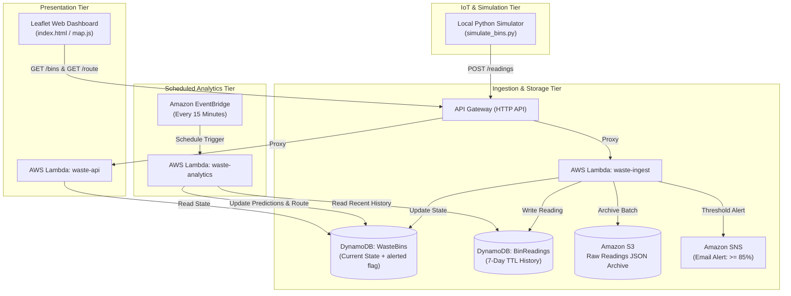

# 00 - Project Overview

> **Status:** Architecture Design Document (Planned Implementation)

---

## 1. Problem Statement
Urban waste management operations typically rely on fixed, static schedules where collection vehicles visit waste bins regardless of their actual fill levels. This leads to:
* **Inefficient Fuel & Resource Usage:** Trucks visit half-empty bins, wasting fuel and labor hours.
* **Overflow & Environmental Hazards:** High-traffic bins overflow prior to scheduled visits, causing litter, odor, and health risks.
* **Lack of Visibility:** Municipalities lack real-time data on bin statuses, filling trends, and collection bottlenecks.

The **AWS Smart Waste Monitoring and Collection Optimization System** resolves these issues by using IoT telemetry, serverless cloud analytics, and combinatorial route optimization to enable dynamic, on-demand waste collection.

---

## 2. Key Objectives & Target Metrics
* **Real-Time Telemetry Monitoring:** Ingest fill-level readings from distributed smart bins via AWS API Gateway and AWS Lambda.
* **Threshold Alerting with Hysteresis:** Trigger instant email alerts via Amazon SNS when a bin crosses **85% capacity**, while suppressing duplicate alerts until the bin is collected and drops below **50%**.
* **Predictive Forecasting:** Use Ordinary Least Squares (OLS) linear regression on recent historical readings to forecast when bins will reach **90% capacity**.
* **Route Optimization:** Select critical bins and solve the Traveling Salesperson Problem (TSP) using Nearest-Neighbour heuristic followed by 2-Opt edge improvement to minimize travel distance.
* **Interactive Visualization:** Display live bin states, status tiers, and the calculated collection path on a zero-build Leaflet.js web dashboard.

---

## 3. High-Level Architecture Diagram

---

## 4. Planned vs. Verified Matrix

| Feature | Design Specification | Verification Method | Current Status |
| :--- | :--- | :--- | :--- |
| **Ingestion Lambda** | Validates schema, writes DynamoDB, archives S3 | Offline unit tests with `moto` | **Integration-Verified** |
| **Alert Hysteresis** | Alert at $\ge 85\%$, reset at $< 50\%$ with `alerted` flag | `test_waste_ingest.py` | **Integration-Verified** |
| **7-Day TTL Storage** | Epoch timestamp calculation for DynamoDB | TTL calculation unit tests | **Integration-Verified** |
| **Linear Regression** | Predicts hours to 90% capacity via slope/intercept | Mathematical validation tests | **Integration-Verified** |
| **Route Optimization** | Nearest-Neighbour + 2-Opt TSP solver | Distance comparison tests | **Integration-Verified** |
| **API Endpoints** | GET `/bins` and GET `/route` via `waste-api` | API proxy event mock tests | **Integration-Verified** |
| **Local Simulator** | Sends JSON telemetry with noise model | Local execution test | **Integration-Verified** |
| **Web Dashboard** | Leaflet map with colored markers and route polyline | DOM & schema integration tests | **Integration-Verified** |

---

## 5. College Project Demonstration Flow
1. **Initial State:** Run dashboard showing 10–15 bins around a campus/city in "Normal" (green) status.
2. **Simulation Launch:** Start `simulate_bins.py` to generate progressive filling and localized surge events.
3. **Threshold Alert:** High-traffic bin reaches $\ge 85\%$, triggers SNS notification, updates status to "Critical" (red), and sets `alerted = true`.
4. **Scheduled Analytics Run:** EventBridge triggers `waste-analytics`, computing linear regression slope and generating an optimized collection route displayed dynamically on the dashboard.
5. **Collection Reset:** Emptying a bin sets fill level $< 50\%$, resetting `alerted = false` on next reading.

