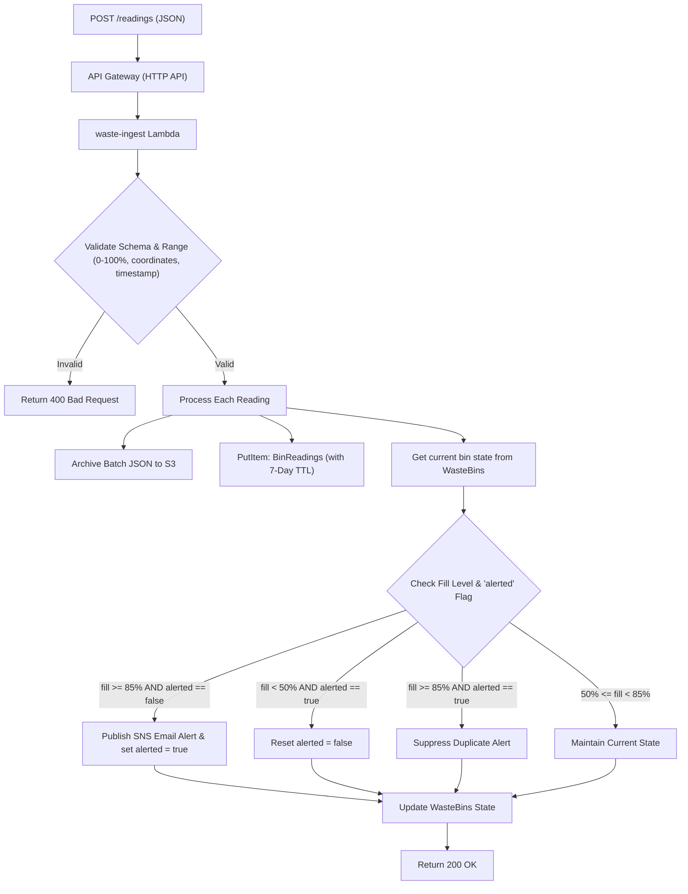

# 03 - Ingestion Lambda & API Gateway

> **Status:** Implementation Complete / Unit Tests Verified (7/7 Passed)

---

## 1. Ingestion Overview
The `waste-ingest` Lambda function (`lambdas/waste_ingest/lambda_function.py`) acts as the ingestion boundary between the field devices (or simulator) and the AWS cloud backend. It is invoked via API Gateway HTTP API via `POST /readings` or directly with a JSON payload.



---

## 2. Ingestion Payload Specification

```json
{
  "readings": [
    {
      "bin_id": "BIN-001",
      "location_name": "Campus Library Courtyard",
      "fill_level": 87.5,
      "latitude": 40.7128,
      "longitude": -74.0060,
      "timestamp": 1760721300000
    }
  ]
}
```

### Validation Rules
1. `bin_id`: Non-empty string.
2. `fill` or `fill_level`: Floating point number strictly bounded between `0.0` and `100.0`.
3. `latitude`: Valid float between `-90.0` and `90.0`.
4. `longitude`: Valid float between `-180.0` and `180.0`.
5. `timestamp`: Valid epoch integer/float (seconds or milliseconds) or ISO 8601 string.
6. If validation fails for any reading in a batch, the Lambda responds with `400 Bad Request` and detailed error descriptions.

---

## 3. Seven-Day Time-to-Live (TTL) Calculation
Each written historical item in DynamoDB `BinReadings` calculates an epoch expiration:
$$\text{ttl} = \text{timestamp\_seconds} + (7 \times 86400)$$
This ensures automatic item expiration by DynamoDB without extra operational write overhead.

---

## 4. Alert Hysteresis Logic (85% / 50%)

To prevent "alert fatigue" caused by fluctuating sensor readings around a threshold, `waste-ingest` tracks an `alerted` boolean attribute in `WasteBins`:

```python
if fill_level >= alert_threshold: # 85.0%
    if not current_alerted:
        sns.publish_threshold_alert(bin_id, fill_level, timestamp_iso, latitude, longitude)
        new_alerted = True
    else:
        new_alerted = True  # Duplicate suppressed
elif fill_level < reset_threshold: # 50.0%
    new_alerted = False     # Bin emptied / collected; alert state reset
else:
    new_alerted = current_alerted # Retain existing state
```

---

## 5. Verification Status
* **Source Implementation:** Completed in [`lambdas/waste_ingest/lambda_function.py`](file:///c:/Users/asus/Desktop/aws%20project/lambdas/waste_ingest/lambda_function.py).
* **Shared Modules:** Completed in [`lambdas/common/`](file:///c:/Users/asus/Desktop/aws%20project/lambdas/common/).
* **Unit Tests:** Implemented in [`tests/test_waste_ingest.py`](file:///c:/Users/asus/Desktop/aws%20project/tests/test_waste_ingest.py).
* **Status:** **VERIFIED** (7/7 tests passing in offline test suite).
